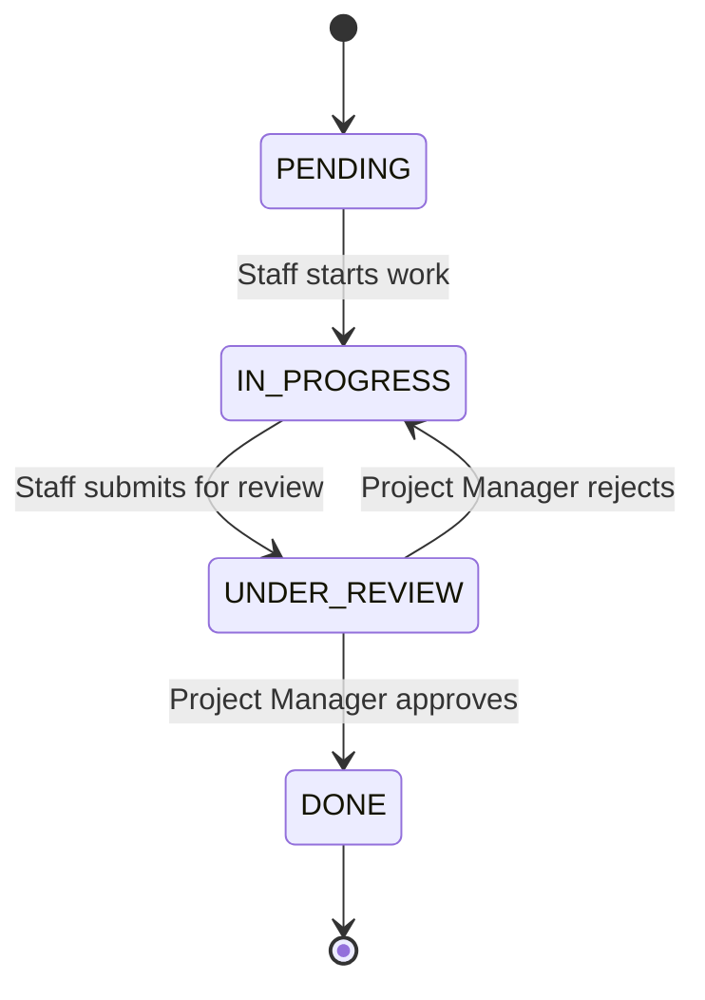

# FimeBag Task Management API

A REST API for managing users, projects, tasks and the work done on them, with a task review workflow and a full audit trail. Built with Java and Spring Boot for FimeBag Limited's internal use.

> **Current status:** Week 1 is complete. The design is finished and documented in [`/docs`](docs/). No application code has been written yet. Development starts with Sprint 1 (see the [roadmap](#roadmap)).

---

## Purpose

FimeBag needs one place to manage its internal work. The system lets the company:

- manage **users** and their **roles**
- create **projects** and assign one or more **Project Managers** to each
- create **tasks** inside projects and assign them to Staff
- move tasks through a **review workflow**: Staff submit work, and a Project Manager approves or rejects it
- record **worklogs** (the work done on each task)
- keep an **audit trail** of important activity

## Users and Roles

| Role | Main responsibilities |
|---|---|
| **Administrator** | Manages users and projects, assigns Project Managers, views the audit log. Read-only access to tasks and worklogs |
| **Project Manager** | Creates, assigns and reviews tasks in the projects they manage |
| **Staff** | Works on assigned tasks, submits them for review, records worklogs |

## Task Workflow



Staff cannot mark their own work as done. A rejected task returns to `IN_PROGRESS` with the reviewer's reason attached. A completed task is final.

---

## Technology Stack (planned)

| Area | Choice |
|---|---|
| Language and framework | Java 21, Spring Boot 3.x |
| Web | Spring Web, Bean Validation |
| Database | PostgreSQL, Spring Data JPA (Hibernate), Flyway migrations |
| Security | Spring Security, JWT, BCrypt |
| Mapping and docs | MapStruct, springdoc-openapi (Swagger UI) |
| Build | Maven |
| Testing | JUnit 5, Mockito, Spring Boot Test, Testcontainers |

## How the Application Will Be Structured

A **layered Spring Boot application, grouped by feature** (`user`, `project`, `task`, `worklog`, `audit`). Each feature has its own controller, service, repository, entities and DTOs.

```text
Request → Security filter → Controller → Service → Repository → PostgreSQL
                                          │
                                          ├── Policies (permission and workflow rules)
                                          └── Audit service
```

- **Controllers** receive requests and validate input.
- **Services** apply the business rules.
- **Policies** decide who may do what, and which task status changes are allowed.
- **Repositories** read and write the database.
- **DTOs** are returned to clients. Database entities are never exposed.

Details: [Backend architecture](docs/05-backend-architecture.md).

## API Overview

27 endpoints under `/api/v1`. Full details are in the [API design](docs/04-api-design.md).

| Area | Endpoints | Examples |
|---|---|---|
| Auth | 1 | `POST /auth/login` |
| Users | 6 | `POST /users`, `PATCH /users/{id}/status`, `PATCH /users/me/password` |
| Projects | 8 | `POST /projects`, `POST /projects/{id}/managers` |
| Tasks | 9 | `POST /tasks`, `POST /tasks/{id}/submit-review`, `POST /tasks/{id}/approve` |
| Worklogs | 2 | `POST /tasks/{id}/worklogs` |
| Audit | 1 | `GET /audit-logs` |

All list endpoints support pagination (`page`, `size`, `sort`) and every error uses one standard format.

## Security

Summary of the [security design](docs/06-security-design.md):

- Passwords are stored as **BCrypt** hashes, never in plain text.
- **JWT** access tokens last 60 minutes. The user is checked against the database on every request, so a deactivated user is blocked at once.
- Every request gets two checks: the **role**, then the **data** (for example, "is this manager assigned to this project?").
- Input is validated, database entities are never returned, and failed logins are rate limited.
- Important actions are written to an **append-only audit log**.
- Secrets come from environment variables and are never committed. See `.env.example`.

---

## Development Approach

- **Design first.** Requirements, use cases, database, API, architecture and security were documented before any code.
- **Dependency-based order with agile sprints.** Dependencies decide what is built first (security before users, projects before tasks). Two-week sprints deliver working, tested endpoints and end with a demo and review. See the [development plan](docs/08-development-plan.md).
- **Branches and pull requests.** No one works directly on `main`. Every change goes through a branch and a pull request. See [CONTRIBUTING.md](CONTRIBUTING.md).
- **Clear history.** Small commits with [Conventional Commit](https://www.conventionalcommits.org/) messages.
- **Tests with code.** Business rules, such as the task workflow and access rules, are covered by unit tests.
- **Recorded decisions.** Important choices and their reasons are in the [technical decision log](docs/09-technical-decision-log.md).

### Branches

| Branch | Purpose |
|---|---|
| `main` | Stable, reviewed work only. Changed only by pull request |
| `develop` | Integration branch. Feature and documentation branches merge here |
| `docs/*`, `feature/*`, `fix/*`, `chore/*` | Short-lived working branches |

## Roadmap

| Sprint | Goal | Status |
|---|---|---|
| 0 | Design (Week 1) | Done |
| 1 | Foundation and database | Next |
| 2 | Security, users and audit service | Planned |
| 3 | Projects and Project Managers | Planned |
| 4 | Tasks | Planned |
| 5 | Review workflow | Planned |
| 6 | Worklogs and audit log API | Planned |
| 7 | Hardening, testing and deployment | Planned |

---

## Documentation

| # | Document | Status |
|---|---|---|
| 1 | [Requirements analysis](docs/01-requirements-analysis.md) | Done |
| 2 | [Use cases](docs/02-use-cases.md) | Done |
| 3 | [Database design](docs/03-database-design.md) | Done |
| 4 | [API design](docs/04-api-design.md) | Done |
| 5 | [Backend architecture](docs/05-backend-architecture.md) | Done |
| 6 | [Security design](docs/06-security-design.md) | Done |
| 7 | Git repository (this repository) | Done |
| 8 | [Development plan](docs/08-development-plan.md) | Done |
| 9 | [Technical decision log](docs/09-technical-decision-log.md) | Done |

## Repository Structure

```text
.
├── README.md
├── CONTRIBUTING.md
├── .gitignore
├── .env.example               example settings (copy to .env, never commit .env)
├── .github/
│   └── pull_request_template.md
└── docs/
    ├── 01-requirements-analysis.md
    ├── 02-use-cases.md
    ├── 03-database-design.md
    ├── 04-api-design.md
    ├── 05-backend-architecture.md
    ├── 06-security-design.md
    ├── 08-development-plan.md
    ├── 09-technical-decision-log.md
    ├── images/                diagrams (use cases, ERD)
    └── diagrams/              diagram sources (ERD in DBML)
```

The application code (`src/`, `pom.xml`) will be added from Sprint 1.

## Getting Started

Not available yet, because there is no code to run. Once Sprint 1 is done, this section will explain how to:

1. start PostgreSQL with Docker Compose
2. copy `.env.example` to `.env` and fill in the values
3. run the application with Maven

## Contributing

Please read [CONTRIBUTING.md](CONTRIBUTING.md) for the branch rules, commit message format and pull request process.
