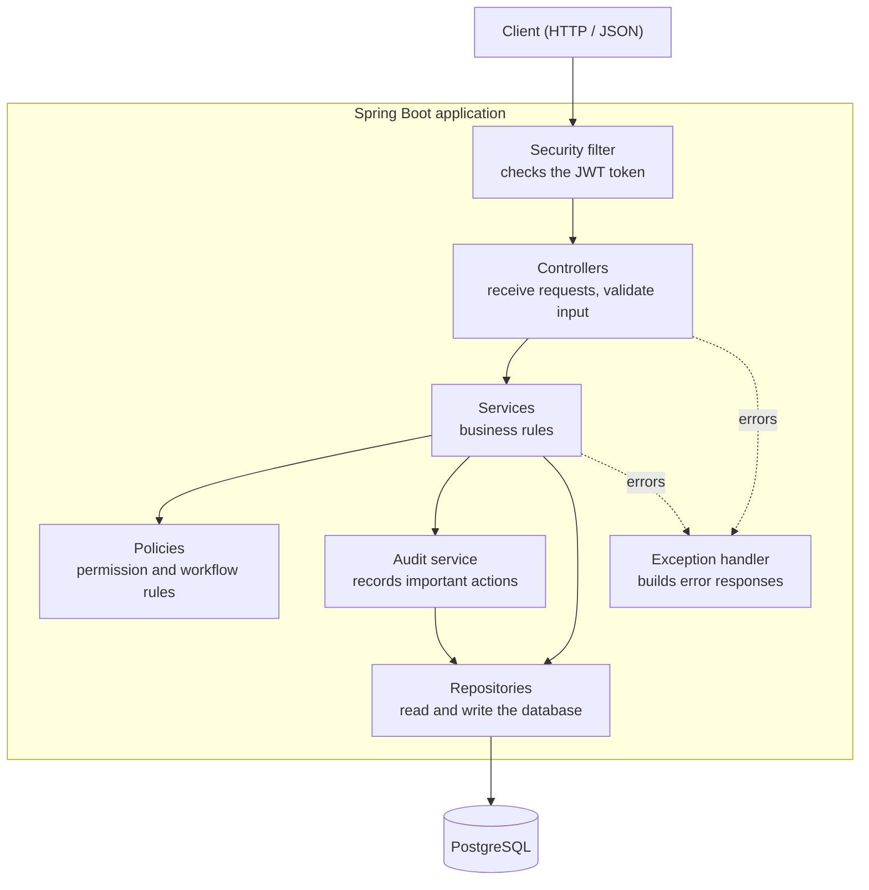

# Backend Architecture

**Project:** FimeBag Internal Task Management API
**Deliverable:** 5 of 9, Week 1
**Depends on:** `01-requirements-analysis.md`, `03-database-design.md`, `04-api-design.md`

---

## 1. What This Document Explains

The backend is the part of the system that users never see. It receives requests, checks who is asking, applies the rules, and saves data in the database.

A **backend architecture** is the plan for how that code is organised: which parts exist, what each part does, and which parts may talk to each other. A clear plan keeps the code easy to read, test and change.

---

## 2. What the Design Must Handle

| Need | Where it comes from | What it means for the design |
|---|---|---|
| Different roles can do different things | Roles and rules 1 to 4, 20 | Two permission checks: one for the role, one for the data |
| Tasks follow a review workflow | Rules 17 to 23 | The workflow rules live in one place |
| Users see different data | API design, section 1 | Queries must depend on who is asking |
| Important actions are recorded | Audit trail requirement | One reusable audit component |
| Passwords must never leak | Authentication requirements | Never return database entities directly |
| Errors look the same everywhere | API design, section 11 | One place that builds error responses |
| Small system, one database, one team | The brief | Keep it simple |

---

## 3. The Proposed Architecture

A **layered Spring Boot application, grouped by feature**.

- **Layered:** the code is split into layers. Each layer has one job.
- **Grouped by feature:** the code for users, projects, tasks, worklogs and audit each lives in its own package.



**One rule keeps it clean:** calls only go downwards. A controller calls a service. A service calls a repository. A repository never calls a service, and a controller never calls a repository.

---

## 4. What Each Part Does

| Part | Its job | It must not |
|---|---|---|
| **Controller** | Receives the request, checks the input is valid, calls one service method, returns the response | Contain business rules, or talk to the database |
| **Service** | Applies the business rules and controls the transaction (all steps succeed, or none do) | Know about HTTP |
| **Policy** | Answers one question, e.g. "is this manager assigned to this project?" or "is this status change allowed?" | Save data |
| **Repository** | Reads and writes the database (Spring Data JPA) | Make business decisions |
| **Entity** | A Java class that matches a database table | Be sent out through the API |
| **DTO** | A simple object that carries data into and out of the API | Reuse entity classes |
| **Mapper** | Converts entities to DTOs and back | Contain logic |
| **Audit service** | Saves one audit log entry: who did what, to which record, when | Decide what is worth auditing (the service decides) |
| **Security filter** | Checks the login token before any controller runs | Decide business permissions |
| **Exception handler** | Turns every error into the standard error response | Hide errors or show stack traces |

---

## 5. Folder Structure

```text
com.fimebag.taskmanager
├── config/        Spring settings (security, API docs)
├── security/      JWT token handling and the security filter
├── common/        Shared code: exceptions, error format, paging
│
├── auth/          Login
├── user/          Users and roles
├── project/       Projects and their managers
│     ├── ProjectController
│     ├── ProjectService
│     ├── ProjectRepository
│     ├── Project, ProjectManager        (entities)
│     ├── ProjectStatus                  (PLANNED, ACTIVE, ON_HOLD, COMPLETED)
│     ├── ProjectAccessPolicy            (who can see or manage a project)
│     └── dto/
├── task/          Tasks and the review workflow
│     ├── TaskController, TaskService, TaskRepository
│     ├── Task, TaskStatus, TaskPriority
│     ├── TaskWorkflow                   (allowed status changes)
│     └── dto/
├── worklog/       Work recorded on tasks
└── audit/         Audit trail (read-only API)
```

Every feature package follows the same pattern as `project/` above.

---

## 6. Key Decisions

### 6.1 Two permission checks
1. **Role check, enforced by Spring Security (method security).** For example, only an Administrator can create users. It is a short annotation on the endpoint: `@PreAuthorize("hasRole('ADMIN')")`. Spring Security runs it before the method starts, so the controller contains no role-checking code.
2. **Data check, in the service.** Some rules depend on the data, such as "this manager is assigned to *this task's project*". An annotation cannot check that, so a policy class does it.

The server enforces every rule. It never trusts the front end to hide buttons.

### 6.2 The task workflow lives in one place
`TaskWorkflow` holds the allowed status changes and who may make them:

```text
PENDING → IN_PROGRESS       assigned Staff member
IN_PROGRESS → UNDER_REVIEW  assigned Staff member (submit for review)
UNDER_REVIEW → DONE         assigned Project Manager (approve)
UNDER_REVIEW → IN_PROGRESS  assigned Project Manager (reject, with a reason)
```

Any other change is refused with HTTP 409. Four statuses are simple enough for a plain enum. A state-machine framework would be more than we need.

### 6.3 The user is checked on every request
A login token stays valid until it expires, even if the user is deactivated afterwards. To stop that, the security filter loads the user from the database on every request. It costs one quick lookup, and a deactivated user or a changed role takes effect straight away.

### 6.4 Audit entries are saved inside the same transaction
The service records the audit entry in the same transaction as the action. Either both are saved, or neither is. The audit log can never say something happened when it did not. One exception: a **failed login** is saved separately, so it is still recorded even though the login failed.

### 6.5 Entities are never returned
Every response is built from a DTO. This keeps `password_hash` out of responses and lets the API change without changing the tables.

### 6.6 Visibility is handled in the database query
The queries only fetch what the user is allowed to see. Loading everything and filtering in Java would be slower and would break page counts.

### 6.7 The database changes through migration scripts
Flyway scripts create and change the tables. Hibernate only **checks** the schema; it never changes it. Every database change is therefore a reviewed file in Git.

### 6.8 Secrets stay out of Git
The database password and the token signing key come from environment variables. Settings are split into `dev`, `test` and `prod` profiles.

### 6.9 Review feedback is stored on the task
When a Project Manager approves or rejects a task, the comment is saved in `tasks.review_comment` and returned as `reviewComment` in the task response. For a rejection the reason is required, so the assigned Staff member can always see why their work was sent back.

Only the latest comment is kept on the task. Each approval or rejection replaces it, so an old rejection reason does not stay on a task that is later approved. The audit log keeps every comment as history.

---

## 7. Example: Approving a Task

`POST /api/v1/tasks/{id}/approve`

1. **Security filter:** checks the token and loads the user. Invalid token or deactivated user: **401**.
2. **Spring Security (method security):** checks the role is Project Manager (otherwise **403**).
3. **Controller:** validates the body and calls `taskService.approve(...)`.
4. **Service**, in one transaction:
   - finds the task (**404** if missing);
   - asks `ProjectAccessPolicy` if this manager is assigned to the task's project (**403** if not);
   - asks `TaskWorkflow` if `UNDER_REVIEW → DONE` is allowed (**409** if not);
   - sets the status to `DONE`, fills `completed_at`, and saves the comment as the task's review comment;
   - saves the task through the repository;
   - records the audit entry `TASK_APPROVED`, with the comment in `details`.
5. **Mapper:** turns the task into a response DTO.
6. **Controller:** returns **200 OK**.

If any step fails, everything is rolled back and the exception handler returns the standard error response.

---

## 8. Why This Architecture

**It matches the problem.** This is a standard application with real business rules, one database and one small team. A layered design handles that directly. Each layer has a clear job that is easy to explain and test.

**What I added to the basic layered shape, and why**

| Addition | Reason |
|---|---|
| Grouped by feature | All task code is in one place. Changing the workflow touches one package |
| Policy classes | A rule like "is this manager assigned?" is written once, not copied into many services |
| DTOs and mappers | Passwords and internal fields never leave the system |
| Audit service | Auditing is needed by every feature, so one component keeps it consistent |
| Security filter and exception handler | Login checks and error format must be identical for every endpoint |

**Other options I considered and rejected**

| Option | Why not |
|---|---|
| **Microservices** | Seven tables and one team. It would add network calls and deployment work for no benefit |
| **Hexagonal (clean) architecture** | Useful when you must swap databases or add many integrations. We have one database, so the extra interfaces would add code but little value. The layered design can grow into it later |
| **Spring Data REST** (endpoints generated from repositories) | Exposes entities and cannot enforce the review workflow or role-based visibility |
| **Audit with AOP or database triggers** | Automatic, but hidden. It cannot record business meaning such as "approved with this comment" |
| **State-machine framework** | Four statuses fit in a simple enum |
| **Grouped by layer** (all controllers together, all services together) | Scatters one feature across several folders |

---

## 9. Tools

| Area | Choice |
|---|---|
| Language and framework | Java 21, Spring Boot 3.x |
| Web | Spring Web, Bean Validation |
| Database access | Spring Data JPA (Hibernate), PostgreSQL |
| Migrations | Flyway |
| Security | Spring Security, JWT, BCrypt password hashing |
| Mapping | MapStruct |
| API documentation | springdoc-openapi (Swagger UI) |
| Build | Maven |
| Testing | JUnit 5, Mockito, Spring Boot Test, Testcontainers |

---

## 10. Testing

| Level | What is tested | Tools |
|---|---|---|
| Unit | Policies and services: workflow changes, permission rules, rule failures. No database needed | JUnit 5, Mockito |
| Controller | Validation, status codes, error format, role restrictions | `@WebMvcTest` |
| Repository | Role-based queries and constraints against a real PostgreSQL | `@DataJpaTest`, Testcontainers |
| Integration | A full flow: create task → assign → start → submit → approve | `@SpringBootTest` |

---

## 11. Known Limits

- **Two people changing one task at the same moment** are protected only by the transaction. The schema has no version column. Adding one to `tasks` would fix this.
- **No logout or refresh token** in this version. Tokens expire quickly, and a deactivated user is blocked immediately (see 6.3).
- **Only the latest review comment** is kept on the task. Earlier ones stay in the audit log.
- **The user lookup on every request** adds one query each time. A short-lived cache could be added if load became a problem.
