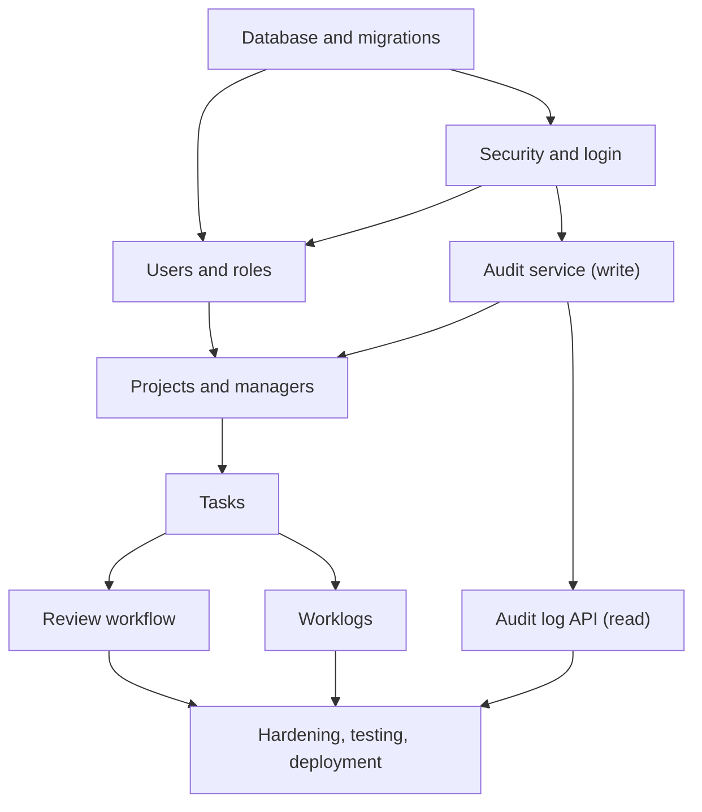
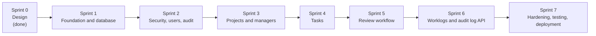

# Development Plan

**Project:** FimeBag Internal Task Management API
**Deliverable:** 8 of 9, Week 1
**Depends on:** `03-database-design.md`, `04-api-design.md`, `05-backend-architecture.md`, `06-security-design.md`

---

## 1. Planning Approach: Dependencies Decide the Order, Sprints Decide the Rhythm

This plan combines two ideas.

| Idea | What it means | What it decides in this plan |
|---|---|---|
| **Dependency-based development** | Work is ordered by what must exist before something else can be built | The **order** of the sprints and the stories inside them |
| **Agile sprints** | Short, fixed-length cycles. Each one ends with working, tested software that is shown and reviewed | The **rhythm**: planning, building, demo, review, adjusting |

### Why a hybrid?

This system has hard dependencies that cannot be ignored:

- Nothing can be protected until **login and security** exist.
- **Projects** need users and roles. **Tasks** need projects. **Worklogs** need tasks.
- Almost every feature must write to the **audit log**, so the audit service must exist before them.

If work were picked in any order, as in a loose agile backlog, a sprint could end up with stories that cannot be finished or tested because their foundations are missing. But a strict one-way plan, where all design, then all code, then all testing happens in sequence, finds problems late and shows nothing working until the end.

So the plan works like this:

1. The **dependency chain** fixes the order of the sprints.
2. Each sprint builds **vertical slices**: complete, working endpoints (controller, service, repository, database and tests), not one layer at a time.
3. Each sprint ends with a **demo** and a **review**. What is learned can change the plan for the next sprint.

### Other approaches considered

| Approach | Why not |
|---|---|
| **Waterfall** (build everything, then test) | Problems are found at the end, and nothing can be shown early |
| **Pure Scrum** (pick stories freely by value) | The value order and the dependency order differ here. Free choice would cause blocked work |
| **Build by layer** (all entities, then all services, then all controllers) | Nothing works end to end until the last layer is finished |

---

## 2. Assumptions

The brief does not state the project length or team size, so the plan assumes the following. All of it can be adjusted.

| Assumption | Value |
|---|---|
| Team | One developer |
| Sprint length | 2 weeks (about 10 working days) |
| Planned load per sprint | About 8 days of work, leaving about 20% for surprises, reviews and learning |
| Size of a story | **S** about half a day, **M** about 1 day, **L** about 2 days |
| Priority | **Must** (the sprint fails without it), **Should** (important, can slip), **Could** (nice to have) |
| Sprint 0 | Week 1: this design work |

If the real sprint length or deadline is different, the order of the sprints does not change. Only the number of stories per sprint does, starting with the *Could* and *Should* items.

---

## 3. Dependencies

| Feature | Needs first | Why |
|---|---|---|
| Security and login | Database, roles | Users and roles are stored in the database |
| Users | Security | Only an Administrator may manage users, so authentication must work |
| Audit service (write) | Database | It saves rows into `audit_logs`. All later features call it |
| Projects | Users, security, audit | A project needs Project Managers (users) and records audit entries |
| Tasks | Projects | A task belongs to a project |
| Review workflow | Tasks | It changes the status of existing tasks |
| Worklogs | Tasks | A worklog belongs to a task |
| Audit log API | Audit service | It reads what the audit service has written |
| Hardening and deployment | Everything | It tests and ships the whole system |

**Critical path:** Database → Security → Users → Projects → Tasks → Review workflow → Hardening. A delay on any step delays everything after it.

**Items that can move:** the audit log API, worklogs and CI can be built at any time once their needs are met. If a sprint is blocked, one of these is pulled in so the time is not wasted.

---

## 4. Sprint Overview

| Sprint | Goal | Endpoints | Planned days | Needs |
|---|---|---|---|---|
| **0** | Design the system (Week 1) | none | done | |
| **1** | A running app connected to PostgreSQL, with the schema in place | 0 | 5 | Design |
| **2** | Login, security, user management and the audit service | 7 | 8 | Sprint 1 |
| **3** | Projects and Project Manager assignment | 8 | 7.5 | Sprint 2 |
| **4** | Create, list, update and assign tasks | 5 | 6 | Sprint 3 |
| **5** | The task review workflow (the core business rules) | 4 | 6 | Sprint 4 |
| **6** | Worklogs and the audit log API | 3 | 5 | Sprints 4 and 2 |
| **7** | Test, harden, document and deploy | 0 | 7.5 | Sprints 1 to 6 |

Endpoints add up to 27, the full API design.

---

## 5. Sprint Details

### Sprint 0: Design (Week 1, done)

Requirements, use cases, database, API, architecture, security, Git repository, this plan and the decision log.

---

### Sprint 1: Foundation and Database

**Goal:** the application starts, connects to PostgreSQL, and the database schema exists.

**Why first:** everything else stands on this. Starting here also settles the tools (Docker, Flyway, CI) while the code is still small.

| ID | Story | Size | Priority |
|---|---|---|---|
| 1.1 | Create the Spring Boot project (Maven, Java 21) with the package structure from the architecture | S | Must |
| 1.2 | Run PostgreSQL locally with Docker Compose. Set up `dev` and `test` profiles and environment variables | S | Must |
| 1.3 | Flyway migrations for the 7 tables, with constraints and indexes. Insert the three roles | M | Must |
| 1.4 | JPA entities and enums (`RoleName`, `ProjectStatus`, `TaskStatus`, `TaskPriority`) with timestamps | M | Must |
| 1.5 | Common error handling: `ApiError`, `GlobalExceptionHandler`, custom exceptions, `PageResponse` | S | Must |
| 1.6 | GitHub Actions: build and test on every pull request | S | Should |
| 1.7 | Testcontainers set-up and a first repository test | S | Should |
| 1.8 | Swagger UI and a health endpoint | S | Could |

**Done when:** the app starts, migrations run on an empty database, Hibernate validates the schema, CI is green and one test passes against a real PostgreSQL.

**Risk:** database or Docker set-up problems. *Answer:* do these first, and keep the set-up simple.

---

### Sprint 2: Security, Users and Audit Service

**Goal:** a user can log in, and an Administrator can manage users. Every later feature can write to the audit log.

**Why now:** security is the largest dependency. Every later endpoint needs authentication and the role check. The audit service is built here so the later sprints can call it from day one.

| ID | Story | Size | Priority |
|---|---|---|---|
| 2.1 | `AuditService` and `AuditLog` entity. Insert and read only | S | Must |
| 2.2 | BCrypt password hashing and password rules | S | Must |
| 2.3 | JWT service and security filter (user loaded from the database on every request). Stateless configuration | L | Must |
| 2.4 | `POST /auth/login`: generic errors, 403 for deactivated users, `LOGIN` and `LOGIN_FAILED` audit entries | M | Must |
| 2.5 | Failed-login limit (429) | S | Should |
| 2.6 | 401 and 403 responses in the standard error format. Turn on method security | S | Must |
| 2.7 | Users: create, list, get, update, activate or deactivate | M | Must |
| 2.8 | `PATCH /users/me/password` | S | Must |
| 2.9 | Create the first Administrator from environment variables | S | Must |
| 2.10 | Tests: login, users and a 401 and 403 test for each role | M | Must |

**Endpoints:** 7. **Done when:** an Administrator logs in and manages users, other roles get 403, a deactivated user is blocked at once, and audit entries are written.

**Risk:** security configuration is the steepest learning curve. *Answer:* follow `06-security-design.md` closely, keep it simple, and let 2.5 slip if needed.

---

### Sprint 3: Projects and Managers

**Goal:** Administrators create and manage projects, and assign Project Managers.

**Why now:** projects need users and roles (Sprint 2). Tasks cannot exist without projects.

| ID | Story | Size | Priority |
|---|---|---|---|
| 3.1 | `POST /projects` with `managerIds` (at least one, all active Project Managers). Starts as `PLANNED` | M | Must |
| 3.2 | Project status changes (`PATCH .../status`) with the allowed transitions | S | Must |
| 3.3 | `PATCH /projects/{id}` | S | Must |
| 3.4 | `ProjectAccessPolicy`: "is this manager assigned to this project?" | M | Must |
| 3.5 | `GET /projects` and `GET /projects/{id}` with role-based visibility, pagination and a sort whitelist | L | Must |
| 3.6 | Managers: add, list and remove (a project always keeps at least one) | M | Must |
| 3.7 | Audit entries for all project actions | S | Must |
| 3.8 | Tests: policy, visibility, last-manager rule, status transitions | M | Must |

**Endpoints:** 8. **Done when:** the Administrator sees every project, a Project Manager sees only theirs, and the project rules (5 to 12) are enforced.

**Dependency note:** Staff see "projects containing their assigned tasks", but tasks do not exist yet. The query is written here and tested properly in Sprint 4.

---

### Sprint 4: Tasks

**Goal:** Project Managers create, assign and update tasks, with the right visibility for each role.

**Why now:** tasks need projects and the access policy (Sprint 3). The review workflow needs tasks to act on.

| ID | Story | Size | Priority |
|---|---|---|---|
| 4.1 | `POST /tasks`: only a manager assigned to the project. Starts as `PENDING`. Optional active Staff assignee | M | Must |
| 4.2 | `PATCH /tasks/{id}` (title, description, priority, due date). It cannot change status | S | Must |
| 4.3 | `POST /tasks/{id}/assign` (active Staff member only) | S | Must |
| 4.4 | `GET /tasks` with filters and role-based visibility (Administrator all, Manager their projects, Staff their own) | L | Must |
| 4.5 | `GET /tasks/{id}` with the data check | S | Must |
| 4.6 | Audit entries and DTO mappers | S | Must |
| 4.7 | Tests, including the Staff project visibility from Sprint 3 | M | Must |

**Endpoints:** 5. **Done when:** a manager creates and assigns tasks, Staff see only their own, and a manager of another project is refused.

---

### Sprint 5: Review Workflow

**Goal:** tasks move through `PENDING → IN_PROGRESS → UNDER_REVIEW → DONE`, with rejection going back to `IN_PROGRESS`.

**Why now:** the workflow acts on existing tasks (Sprint 4). It is the core of the business rules, so it gets a sprint of its own and thorough tests.

| ID | Story | Size | Priority |
|---|---|---|---|
| 5.1 | `TaskWorkflow`: allowed transitions and who may make them | M | Must |
| 5.2 | `PATCH /tasks/{id}/status`: assigned Staff start work | S | Must |
| 5.3 | `POST /tasks/{id}/submit-review` | S | Must |
| 5.4 | `POST /tasks/{id}/approve`: sets `completed_at` | S | Must |
| 5.5 | `POST /tasks/{id}/reject`: reason required | S | Must |
| 5.6 | Save and return `review_comment` (replaced at each decision) | S | Must |
| 5.7 | Audit entries: started, submitted, approved, rejected | S | Must |
| 5.8 | Tests: every allowed and refused change, for every role. Completed tasks are final. A full end-to-end flow | L | Must |

**Endpoints:** 4. **Done when:** Staff cannot mark a task `DONE`, only the assigned manager can approve or reject, invalid changes return 409, and Staff can read the rejection reason.

---

### Sprint 6: Worklogs and Audit Log API

**Goal:** Staff record work, and Administrators read the audit trail.

**Why now:** worklogs need tasks (Sprint 4). The audit log API reads what the audit service has been writing since Sprint 2. This is the lightest sprint, so it doubles as **catch-up time** for earlier sprints.

| ID | Story | Size | Priority |
|---|---|---|---|
| 6.1 | `POST /tasks/{id}/worklogs`: assigned Staff only. Hours above 0, at most 2 decimals | M | Must |
| 6.2 | `GET /tasks/{id}/worklogs`: Administrator, manager of the project, or the assignee. Filters | M | Must |
| 6.3 | `GET /audit-logs` with filters and pagination (Administrator only) | M | Must |
| 6.4 | `GET /audit-logs/{id}` | S | Must |
| 6.5 | `WORKLOG_CREATED` audit entry. Audit repository exposes save and read only | S | Must |
| 6.6 | Tests | M | Must |

**Endpoints:** 3. **Done when:** all 27 endpoints from the API design exist.

---

### Sprint 7: Hardening, Testing, Documentation and Deployment

**Goal:** the system is secure, tested, documented and running in a real environment.

**Why last:** this stage checks the whole system, so it needs everything else finished.

| ID | Story | Size | Priority |
|---|---|---|---|
| 7.1 | Security test suite from `06-security-design.md`: no token, every role, expired or forged tokens, mass assignment, bad sort values, no secrets in responses | L | Must |
| 7.2 | Integration tests of full flows: project → task → workflow → worklog → audit | M | Must |
| 7.3 | Performance review: repeated-query (N+1) problems, indexes, page-size cap | M | Should |
| 7.4 | Database privileges: a separate migration user, and `INSERT` and `SELECT` only on `audit_logs` | S | Must |
| 7.5 | Production configuration: HTTPS, CORS, Swagger off, secrets from the environment | S | Must |
| 7.6 | Dockerfile and deployment to the environment FimeBag provides | M | Must |
| 7.7 | Update the README (Getting Started) and check the code against the design documents | S | Must |
| 7.8 | Bug-fix buffer and the final demonstration | M | Must |

**Done when:** all tests pass, the application runs in the target environment, and the documents match the code.

---

## 6. How Each Sprint Runs

| Step | What happens |
|---|---|
| **Sprint planning** | Pick stories from the next sprint's list. Check that everything each one depends on is done. If it is not, swap in an independent story |
| **Board** | A GitHub Projects board: Backlog, Ready, In progress, In review, Done. Each story is an issue |
| **Building** | One branch per story (`feature/<topic>`), small commits, a pull request into `develop` |
| **Mid-sprint check** | Look at the board. Is the sprint on track? If not, cut a *Could* or *Should* story now, not at the end |
| **Sprint review (demo)** | Show the working endpoints in Swagger or Postman to Fisayo Fagbemi. Collect feedback |
| **Retrospective** | Short notes: what went well, what to change. Adjust the next sprint |
| **Release** | Pull request `develop` → `main`, tagged `v0.<sprint>.0` (for example `v0.2.0` after Sprint 2) |

### Definition of Done (every story)

- Code is on a branch and merged by pull request. Nothing is committed directly to `main` or `develop`.
- The endpoint matches `04-api-design.md`: URL, status codes and error format.
- Business rules are enforced in the service or policy, not only in the controller.
- Unit tests cover the rules. Controller tests cover validation, status codes and 401 and 403.
- Audit entries are written where the design requires them.
- No secrets, passwords or tokens are in code, logs or responses.
- If the design changed, the document is updated and the decision is added to the Technical Decision Log.

---

## 7. Handling Change and Delays

- **A story is blocked:** pull in an independent story (CI, documentation, tests, the audit log API) rather than waiting.
- **A sprint is running late:** cut in this order: *Could*, then *Should*, then move the story to the next sprint. *Must* stories are never dropped.
- **A slipped story moves forward**, and the dependency table shows what else it holds up.
- **Sprint 6 is the safety net.** It is lighter than the others and can absorb work that slipped from Sprints 2 to 5.
- **Requirements change:** add the item to the backlog, check what it depends on, and place it in the earliest sprint where its needs are met. Record the decision.

---

## 8. Risks

| Risk | Likelihood | Effect | Response |
|---|---|---|---|
| Spring Security takes longer than planned (new topic) | High | Sprint 2 slips and delays everything | Start Sprint 2 with the JWT filter. Follow the security design. Defer 2.5 if needed |
| Estimates are too optimistic | Medium | Sprints overrun | Keep 20% buffer. Use Sprint 6 for catch-up. Re-estimate after Sprint 2 |
| Workflow rules have gaps | Medium | Rework in Sprint 5 | Ask about unclear rules before Sprint 4 starts (see section 10) |
| Deployment environment unknown | Medium | Sprint 7 blocked | Ask early. Use Docker so the application is portable |
| A late design change breaks other documents | Low | Inconsistencies | Update all affected documents in the same pull request |

---

## 9. Not in This Plan (Later)

These were left out on purpose and are recorded for later:

- Logout and refresh tokens
- Password reset
- Multi-factor authentication for Administrators
- Optimistic locking (a `version` column on tasks)
- Audit log retention rules
- Reopening a completed task
- Notifications (email or push)

---

## 10. Open Questions

1. **How long is the project, and how long is a sprint?** The plan assumes 2-week sprints, so about 14 weeks after Week 1.
2. **Where will the application be deployed?** This affects Sprint 7.
3. **Is there a front end or another client that will use the API?** If so, it needs the API documentation early. Sprint 1 provides Swagger.
4. **Which of the "later" items matter most to FimeBag?** Password reset is the most likely to be needed.
